TYPESCRIPT · REACT · NEXT.JS · ANGULAR · REACT NATIVE · NODE.JS · ASP.NET · PYTHON · MONGODB · POSTGRESQL · REDIS · AWS · DOCKER · GSAP · WEBGL

[amr@amrezzat.com](mailto:amr@amrezzat.com) · [LinkedIn](https://www.linkedin.com/in/amrezzatofficial/) · [DS-Mate MCP on npm](https://www.npmjs.com/package/@ds-mate/dsmate-mcp) · AWS Solutions Architect – Associate
